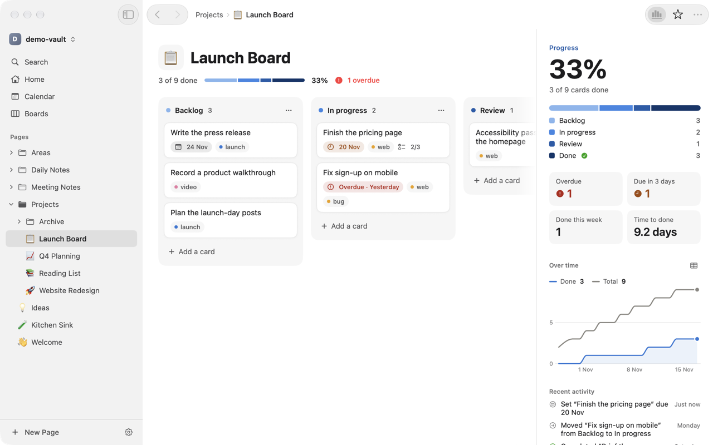

# LP — Local Productivity

A calm, native macOS home for your notes, tasks, calendar and projects, built on a folder of
plain Markdown files.

Point LP at any folder on your Mac and it becomes a workspace: a writing surface that never
shows Markdown syntax, a calendar connected to your Apple, Google and Outlook calendars,
Trello-style boards that track how your projects are going, reminders that reach you even when LP
is closed, and widgets for your desktop. Runs on macOS 15 Sequoia and later. Your notes stay exactly what they
were — plain `.md` files in a folder you own — so the same folder keeps working in Obsidian, in
a text editor, or in Git.


| | |
|---|---|
|  |  |
|  |  |
|  |   |

## What it does

**Notes**

- **Any folder is a workspace.** Choose a folder once; it is remembered between launches.
- **Writing without syntax.** Headings, lists, to-dos, quotes, callouts, code, tables, dividers
  and images appear as what they are. You still *type* Markdown — `# `, `- `, `[] `, `**bold**`,
  `[[link]]` — and the symbols disappear once they have done their job.
- **Blocks and links.** `/` for a menu of blocks, `[[` to link a page, a formatting bar on
  selection, and a handle on every block to move, duplicate or turn it into something else.
- **Home and search.** Recent pages, quick actions and every open task; `⌘K` finds anything.
- **Text your way.** Any size from 12 to 24 pt (`⌘+` / `⌘−` / `⌘0`), compact or relaxed line
  spacing, narrow to full-width pages, and the system font, Rounded, Serif, Mono or any font you
  have installed — with a live preview. The interface (sidebar, lists, boards) has its own size.

**Calendar**

- **Your real calendars, two-way.** Connect Apple Calendar (iCloud and any account in System
  Settings → Internet Accounts), Google Calendar and Microsoft Outlook. Create, edit, move and
  delete events in LP and the change is saved back to the original calendar — including one
  occurrence or a whole series of a repeating event.
- **Next to your notes.** Daily notes, dated pages and due tasks sit beside your events.

**Boards**

- **Trello-style boards** stored as Markdown in your folder (the format Obsidian's Kanban plugin
  uses). Drag cards between lists, or use the keyboard (⌘← / ⌘→). Lists resize with the window.
- **One board per project.** **Boards** in the sidebar shows every board with its progress;
  **New Board…** (`⌥⌘N`) starts one from a template — Simple, Project, Weekly, Content or Bugs.
- **Cards** with due dates, tags, notes and checklists.
- **Progress tracking.** Percent done, cards per list, what's overdue, what's due soon, what got
  done this week, average time to done, a chart over time, and a history of every change —
  even changes made in another app while LP was closed.
- **Share progress** as a live, read-only page that anyone with the link can open on any device
  (a secret GitHub Gist, kept up to date automatically), or export an HTML report. Card notes
  are never shared.

**Reminders and widgets**

- **Reminders** on the day a task or card is due — at its own time if it has one
  (`📅 2026-11-20 14:30` in a note, `@@{14:00}` on a card) or at 9:00 — with **Mark as Done**,
  **Remind Me in an Hour** and **Remind Me Tomorrow**. Alerts before calendar events, and a short
  summary of your day each morning. Choose everything in **Settings → Notifications**.
- **Widgets** for the desktop and Notification Center: **Today** (what's due, overdue and next on
  your calendar) and **Board** (a board's progress). See *Turning on widgets* below.

## How it treats your files

- **Nothing is written unless you edit.** Opening a note or board never changes it.
- **Untouched text is preserved byte for byte**, including bullets, indentation, blank lines,
  emphasis style, list numbering, line endings and text encoding.
- **Nothing is dropped.** Markdown LP doesn't render (HTML, math, footnotes, comments) is kept.
- **Saves are safe** (atomic, keeping creation dates and Finder tags). Deleting moves to the Trash.
- **Board history** lives in a hidden `.lp/` folder in your workspace, out of sight in Obsidian.

Over 650 automated checks guard these promises (`Scripts/test.sh`), including fuzzing with
thousands of generated notes and boards.

## Getting started

**New to LP? The [user guide](docs/LP%20User%20Guide.pdf) explains everything step by step** (it is
also attached to each release).

1. Download `LP-1.0.0.zip` from the newest release on the
   [Releases page](https://github.com/LTF-Git-Dev/local-productivity/releases), unzip it and move LP
   to Applications — or open `Local Productivity.xcodeproj` in Xcode 27 and press **Run** (`⌘R`).
   LP needs macOS 15 or later.
2. Choose a folder. An existing Obsidian vault works as it is; so does an empty folder.
3. Optional: **Settings → Calendars** to connect calendars, **Settings → Notifications** for
   reminders (macOS asks for permission the first time there is something to remind you about),
   **Settings → Sharing** to share board progress.

For the workspace to be remembered reliably between builds, pick your team under
**Signing & Capabilities**. With "Sign to Run Locally", macOS may ask for the folder again after
a rebuild.

### Sharing a board with other people

A board's progress can be shared as a **live, read-only web page** that anyone with the link can
open — on a phone, a PC, any browser, without an account. The page shows the lists, card titles,
due dates, tags, progress and recent activity. **Card notes are never shared.**

1. **Once:** create a GitHub token that can only make gists —
   [github.com/settings/tokens/new?scopes=gist](https://github.com/settings/tokens/new?scopes=gist&description=LP%20progress%20sharing)
   (a free GitHub account is enough). In LP, open **Settings → Sharing**, paste the token and
   click **Connect**. LP checks it and keeps it in your Keychain.
2. Open the board and choose **••• → Share Progress…** (or the chart button in the toolbar) to open
   the progress panel.
3. Under **Share**, click **Share Progress**. LP publishes the page as a *secret* GitHub Gist —
   not listed or searchable, only reachable with its link.
4. Click **Copy Link** and send it to whoever you like (Messages, email, Slack…).
5. The page updates by itself as the board changes (**Keep up to date automatically**), or click
   **Update Now**. **Stop Sharing** deletes the page and the link stops working.

Prefer a file? **Export Report…** in the same panel saves a self-contained HTML report you can
email or AirDrop. And because a board is a plain Markdown file, collaborators who use Obsidian
(with the Kanban plugin) can open the same file from a shared folder.

### Turning on widgets

Widgets read what LP shares with them through an App Group, which macOS only allows between apps
signed with the same team. LP builds are signed ad hoc by default, so the widgets show "Widgets
need setting up" until LP is signed with a team — a free Apple ID works:

1. In Xcode: **Settings → Accounts → +** and sign in with your Apple ID.
2. Open the project, select the **Local Productivity** and **LPWidgetsExtension** targets, and choose
   your team under **Signing & Capabilities** (or run `Scripts/signing-team.sh` to find your team ID
   and build with `LP_TEAM_ID=<team> Scripts/build.sh`, or release with
   `LP_TEAM_ID=<team> Scripts/deploy.sh <version>`).
3. Run LP once, then add the widgets: click the date in the menu bar → **Edit Widgets** → **LP**.

### Connecting Google or Outlook

Apple Calendar needs no setup. Google and Microsoft require an OAuth **client ID** of your own
(free, no secret): Settings → Calendars has step-by-step instructions and links for each. LP
signs in through the system's secure sign-in sheet and keeps tokens in your Keychain.

## Keyboard

| | |
|---|---|
| `⌘N` / `⌥⌘N` / `⇧⌘N` | New page / board / folder |
| `⌘K` · `⌘P` | Search · Quick open |
| `⌘T` | Today's note |
| `⌘1` / `⌘2` / `⌘3` | Home / Calendar / Boards |
| `⌘+` / `⌘−` / `⌘0` | Bigger text / smaller text / default size |
| `⌘[` / `⌘]` | Back / Forward |
| `⌘B` `⌘I` `⇧⌘X` `⇧⌘C` `⇧⌘H` | Bold, italic, strikethrough, code, highlight |
| `⌥⌘0` … `⌥⌘9` | Turn a block into text, headings, to-do, lists, quote, code, callout |
| `/` · `[[` | Block menu · Link to a page |
| Board card: `Return` · `⌘←` `⌘→` · `Delete` | Open · Move to the previous/next list · Delete |

## Documentation

| | |
|---|---|
| [User guide (PDF)](docs/LP%20User%20Guide.pdf) | How to use LP, step by step |
| [Changelog](CHANGELOG.md) | What changed in each version |
| [Product requirements](docs/PRODUCT_REQUIREMENTS.md) | Vision, every feature and its status, roadmap |
| [Architecture](docs/ARCHITECTURE.md) | How LP is built, file formats, sync, security |
| [Design system](docs/DESIGN_SYSTEM.md) | Colours (contrast-checked), type, spacing, components |
| [CODEX.md](CODEX.md) | The complete guide to the project, for Codex and other agents |
| [AGENTS.md](AGENTS.md) · [CLAUDE.md](CLAUDE.md) | Rules and working notes for AI agents |

## Development

```sh
Scripts/test.sh                  # 681 checks: markdown, calendar, safety, widgets, reminders, boards
Scripts/build.sh                 # Debug build, the same as Xcode's (LP_TEAM_ID=… to sign with a team)
Scripts/build.sh harness         # Build used for UI snapshots
Scripts/snapshot.sh home "route:home ;; shot:home"
Scripts/make-demo-vault.sh       # A sample workspace in .build/demo-vault
Scripts/render-widgets.sh        # Draw the widgets (light and dark) into .build/shots/widgets
Scripts/make-user-guide.sh       # Rebuild docs/LP User Guide.pdf from docs/user-guide/
Scripts/deploy.sh 1.1.0 --dry-run  # Check a release without publishing anything
Scripts/rollback.sh 1.0.0        # Restore an earlier release
```

**Nothing is released without the owner's go-ahead, and every release is kept.** Changes are made
on branches; `Scripts/deploy.sh` publishes a version only once it has been confirmed (it asks for
the version to be typed, or needs `--confirmed`), backs up the version it replaces first, and uses
the version's entry in [CHANGELOG.md](CHANGELOG.md) as its release notes. Any release can be
restored with `Scripts/rollback.sh`.

## Known limitations

- Tables are edited in a sheet rather than in place.
- Renaming a page does not yet update `[[links]]` that point to it.
- Google and Outlook sync need your own OAuth client ID (Apple Calendar does not).
- Progress sharing uses GitHub Gists, so it needs a GitHub account and token.
- Widgets need LP signed with a team (see *Turning on widgets*).
- Images on the web are shown as placeholders; local images are displayed.

## Roadmap

See [the roadmap](docs/PRODUCT_REQUIREMENTS.md#9-roadmap): backlinks and an outline, updating
links on rename, a week view, in-place tables, code syntax colouring, and card assignees.
