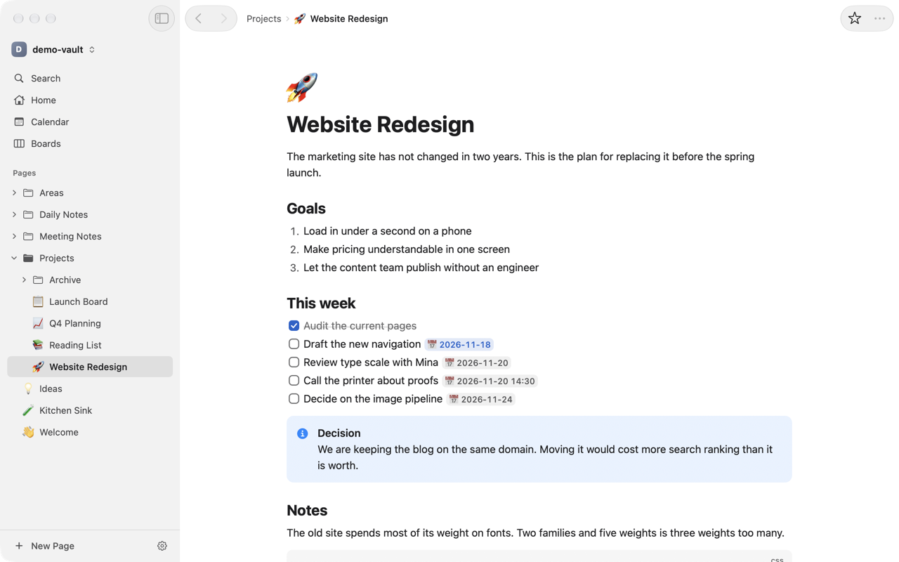
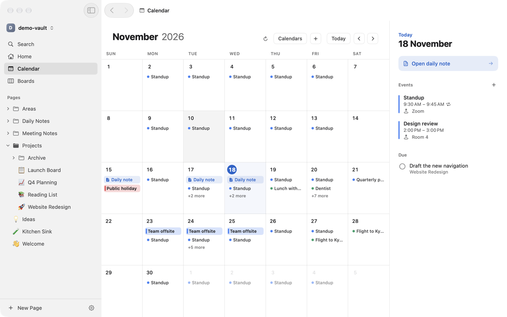
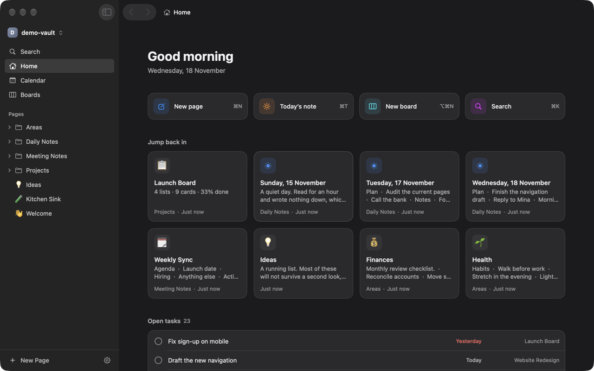
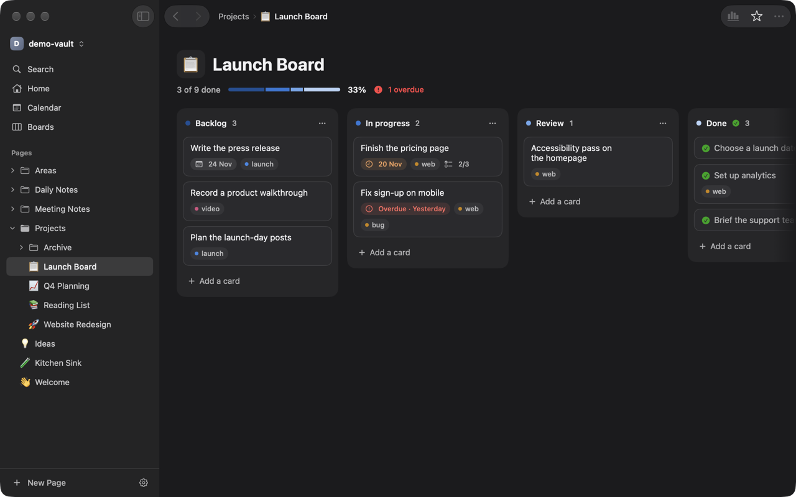
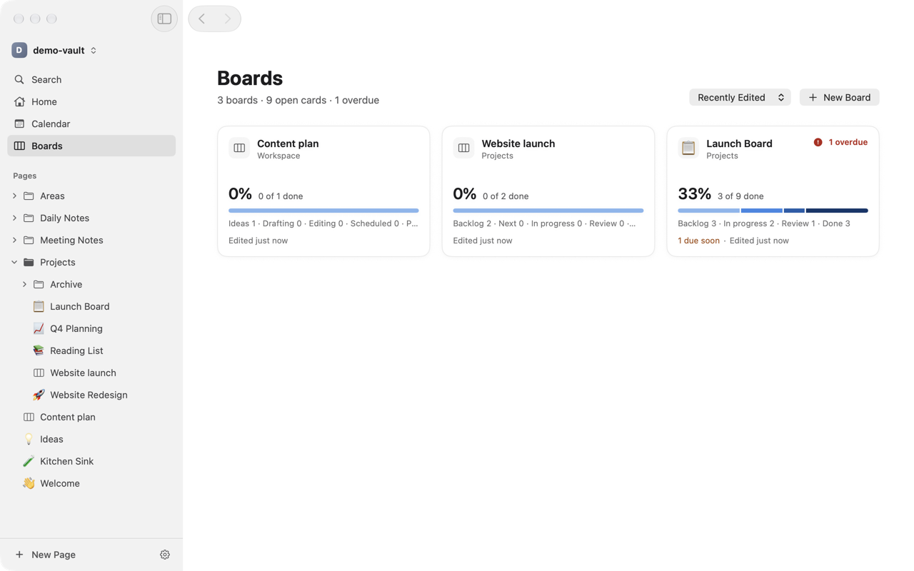
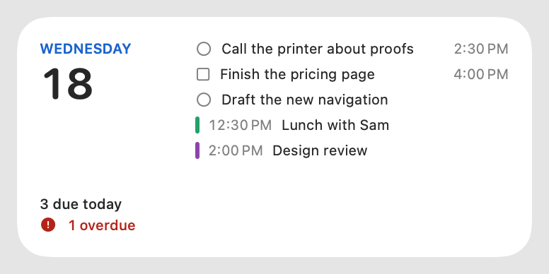
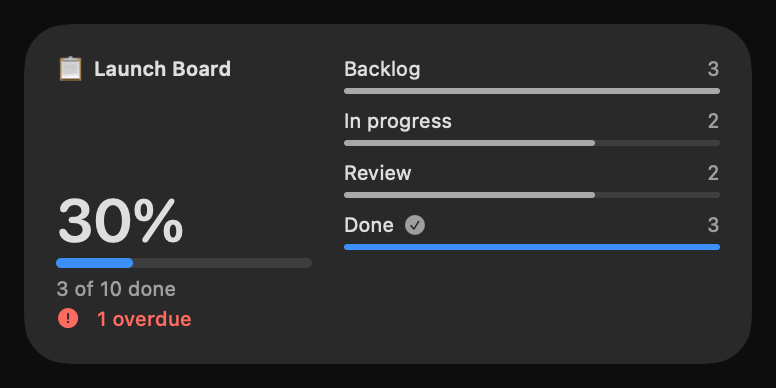

# LP — Local Productivity

A calm, native macOS home for your notes, tasks, calendar and projects, built on a folder of
plain Markdown files.

Point LP at any folder on your Mac and it becomes a workspace: a writing surface that never
shows Markdown syntax, a calendar connected to your Apple, Google and Outlook calendars,
Trello-style boards that track how your projects are going, reminders that reach you even when LP
is closed, and widgets for your desktop. Runs on macOS 15 Sequoia and later. Your notes stay exactly what they
were — plain `.md` files in a folder you own — so the same folder keeps working in Obsidian, in
a text editor, or in Git.



| | |
|---|---|
|  |  |
|  |  |
|  |   |

## What it does

**Notes**

- **Any folder is a workspace.** Choose a folder once; it is remembered between launches.
- **Writing without syntax.** Headings, lists, to-dos, quotes, callouts, code, tables, dividers
  and images appear as what they are. You still *type* Markdown — `# `, `- `, `[] `, `**bold**`,
  `[[link]]` — and the symbols disappear once they have done their job.
- **Blocks and links.** `/` for a menu of blocks, `[[` to link a page, a formatting bar on
  selection, and a handle on every block to move, duplicate or turn it into something else.
- **Home and search.** Recent pages, quick actions and every open task; `⌘K` finds anything.
- **Text your way.** Any size from 12 to 24 pt (`⌘+` / `⌘−` / `⌘0`), compact or relaxed line
  spacing, narrow to full-width pages, and the system font, Rounded, Serif, Mono or any font you
  have installed — with a live preview. The interface (sidebar, lists, boards) has its own size.

**Calendar**

- **Your real calendars, two-way.** Connect Apple Calendar (iCloud and any account in System
  Settings → Internet Accounts), Google Calendar and Microsoft Outlook. Create, edit, move and
  delete events in LP and the change is saved back to the original calendar — including one
  occurrence or a whole series of a repeating event.
- **Next to your notes.** Daily notes, dated pages and due tasks sit beside your events.

**Boards**

- **Trello-style boards** stored as Markdown in your folder (the format Obsidian's Kanban plugin
  uses). Drag cards between lists, or use the keyboard (⌘← / ⌘→). Lists resize with the window.
- **One board per project.** **Boards** in the sidebar shows every board with its progress;
  **New Board…** (`⌥⌘N`) starts one from a template — Simple, Project, Weekly, Content or Bugs.
- **Cards** with due dates, tags, notes and checklists.
- **Progress tracking.** Percent done, cards per list, what's overdue, what's due soon, what got
  done this week, average time to done, a chart over time, and a history of every change —
  even changes made in another app while LP was closed.
- **Share progress** as a live, read-only page that anyone with the link can open on any device
  (a Google Doc in your own Drive or a secret GitHub Gist, kept up to date automatically), or
  export an HTML report. Card notes are never shared.

**Reminders and widgets**

- **Reminders** on the day a task or card is due — at its own time if it has one
  (`📅 2026-11-20 14:30` in a note, `@@{14:00}` on a card) or at 9:00 — with **Mark as Done**,
  **Remind Me in an Hour** and **Remind Me Tomorrow**. Alerts before calendar events, and a short
  summary of your day each morning. Choose everything in **Settings → Notifications**.
- **Widgets** for the desktop and Notification Center: **Today** (what's due, overdue and next on
  your calendar) and **Board** (a board's progress). See *Turning on widgets* below.

## How it treats your files

- **Nothing is written unless you edit.** Opening a note or board never changes it. (Renaming,
  moving or sharing a board adds one line — its ID — to its front matter, so its history and
  shared page stay with it.)
- **Changes made elsewhere are never overwritten.** If another app changed a page since LP read
  it, LP keeps that version as a copy before writing, and tells you. A page or board LP can't
  read is shown as such and never written.
- **If a save fails, your edits are kept** — as a copy in LP's *Recovered* folder
  (`~/Library/Containers/LTF.Local-Productivity/Data/Library/Application Support/LP/Recovered`),
  never in your workspace — and LP's alert has **Show in Finder**.
- **Untouched text is preserved byte for byte**, including bullets, indentation, blank lines,
  emphasis style, list numbering, line endings and text encoding.
- **Nothing is dropped.** Markdown LP doesn't render (HTML, math, footnotes, comments) is kept.
- **Saves are safe** (atomic, keeping creation dates and Finder tags). Deleting moves to the Trash.
- **Board history** lives in a hidden `.lp/` folder in your workspace, out of sight in Obsidian.

Over 750 automated checks guard these promises (`Scripts/test.sh`), including fuzzing with
thousands of generated notes and boards.

## Privacy

**LP has no servers, no accounts, no analytics and no tracking.** Your notes and boards are files
on your Mac. LP only goes online for calendar accounts you connect, boards you share and — once a
day unless you turn it off — to look for a new version on its GitHub page (no account or
identifier is sent). It talks to Google, Microsoft or GitHub directly from your Mac, asking for
the smallest permissions that work. Read the [Privacy Policy](PRIVACY.md) and
[Connected accounts](docs/CONNECTED_ACCOUNTS.md) for the details.

## Getting started

**New to LP? The [user guide](docs/LP%20User%20Guide.pdf) explains everything step by step** (it is
also attached to each release).

1. Download the app (`LP-<version>.zip`) from the release marked **Latest** on the
   [Releases page](https://github.com/LTF-Git-Dev/local-productivity/releases), unzip it and move LP
   to Applications — or open `Local Productivity.xcodeproj` in Xcode 27 and press **Run** (`⌘R`).
   LP needs macOS 15 or later. Releases marked **Pre-release** (`LP-1.0.1-beta.1.zip`, say) are
   betas, published for testing before a version becomes official.
   The first time, macOS may say it "could not verify LP is free of malware" (LP isn't from the
   App Store or notarized by Apple): click **Done**, open
   **System Settings → Privacy & Security** and click **Open Anyway** next to the message about LP.
2. Choose a folder. An existing Obsidian vault works as it is; so does an empty folder.
   After that, LP keeps itself up to date: it checks the Releases page once a day and asks before
   installing (**LP → Check for Updates…**; **Settings → General → Updates** to turn the check off
   or to include betas). Updates are installed only when signed with LP's release key.
3. Optional: **Settings → Calendars** to connect calendars, **Settings → Notifications** for
   reminders (macOS asks for permission the first time there is something to remind you about),
   **Settings → Sharing** to share board progress.

For the workspace to be remembered reliably between builds, pick your team under
**Signing & Capabilities**. With "Sign to Run Locally", macOS may ask for the folder again after
a rebuild.

### Sharing a board with other people

A board's progress can be shared as a **live, read-only web page** that anyone with the link can
open — on a phone, a PC, any browser, without an account. The page shows the lists, card titles,
due dates, tags, progress and recent activity. **Card notes are never shared.**

1. **Once, choose where pages go — always your own account:**
   - **Google Drive:** connect your Google account in **Settings → Calendars**, then click
     **Allow Google Drive…** in **Settings → Sharing**. LP can reach only the files it creates.
     (Only if you use your own client ID: in its Google Cloud project, also turn on the Google
     Drive API and add the `drive.file` permission.)
   - **GitHub:** create a token that can only make gists —
     [github.com/settings/tokens/new?scopes=gist](https://github.com/settings/tokens/new?scopes=gist&description=LP%20progress%20sharing)
     (a free GitHub account is enough) — and paste it in **Settings → Sharing**. LP checks it and
     keeps it in your Keychain.
2. Open the board and choose **••• → Share Progress…** (or the chart button in the toolbar) to open
   the progress panel.
3. Under **Share**, click **Share Progress** (if both are set up, choose where). LP publishes the
   page as a Google Doc in your Drive or a *secret* GitHub Gist — not listed or searchable, only
   reachable with its link. Disconnecting the Google account removes its Docs.
4. Click **Copy Link** and send it to whoever you like (Messages, email, Slack…).
5. The page updates by itself as the board changes (**Keep up to date automatically**), or click
   **Update Now**. **Stop Sharing** deletes the page and the link stops working.

LP only updates pages this Mac published. If a board's page was shared from another Mac — or
from LP 1.0.0, or by whoever gave you the folder — the panel says it was *set up elsewhere* and
changes nothing until you choose **Keep It Updated From Here** (or **Forget It**, which leaves
the page alone). A copy of a board never updates the original's page.

**Is it private? Does it cost anything?** It costs nothing: the page is a Google Doc in your own
Drive or a *secret gist* on your own free GitHub account, and LP has no server. Anyone you give the
link to can open it, and anyone *they* pass it to — it isn't listed or searchable, but it isn't
password-protected. Card notes are never on it. A Google Doc can only be read, not edited; LP
doesn't put your name or email on it, but Google may show viewers which Google account owns it
(its name, possibly its email). Its earlier versions stay in its version history, which only you
can see. A gist shows your GitHub username, and GitHub keeps its earlier versions
until you **Stop Sharing**, which deletes the page and that history (signed-in GitHub users can
also comment on it or fork it). Viewers need no account; LP doesn't track them (Google or GitHub
sees a visit like any website's). Anyone who opened the page can keep a copy. People who share
their own boards use their own accounts; to keep your own identity away from a shared page, share
from a separate free Google or GitHub account.

**Offline?** While it runs and is online, LP syncs your Google and Outlook calendars in full about
every half hour — a year back to two years ahead — and keeps them on your Mac until you disconnect,
so they show without internet
(changing them needs a connection). Apple Calendar works fully offline. See the user guide.

Prefer a file? **Export Report…** in the same panel saves a self-contained HTML report you can
email or AirDrop. And because a board is a plain Markdown file, collaborators who use Obsidian
(with the Kanban plugin) can open the same file from a shared folder.

### Turning on widgets

Widgets read what LP shares with them through an App Group, which macOS only allows between apps
signed with the same team. LP builds are signed ad hoc by default, so the widgets show "Widgets
need setting up" until LP is signed with a team — a free Apple ID works:

1. In Xcode: **Settings → Accounts → +** and sign in with your Apple ID.
2. Open the project, select the **Local Productivity** and **LPWidgetsExtension** targets, and choose
   your team under **Signing & Capabilities** (or run `Scripts/signing-team.sh` to find your team ID
   and build with `LP_TEAM_ID=<team> Scripts/build.sh`, or release with
   `LP_TEAM_ID=<team> Scripts/deploy.sh <version>`).
3. Run LP once, then add the widgets: click the date in the menu bar → **Edit Widgets** → **LP**.

### Connecting Google or Outlook

- **Google:** one-click **Connect Google Account…** is coming soon — Google is still reviewing LP,
  so this beta leaves it out. Until then, add the account to your Mac (below) to see its
  calendars, or use your own client ID (which also lets you share boards to Google Drive). LP signs
  in through the system's secure sign-in sheet, keeps the sign-in in your Keychain and has no server.

- **Outlook:** LP's own Microsoft registration comes in a later version. Until then, add the
  account to your Mac (below) or use your own client ID.

- **No app registration at all:** add the account in System Settings → Internet Accounts (the
  **Add an Account in System Settings…** button) and connect **Apple Calendar** — macOS syncs it.
- **Your own registration:** **Use Your Own Client ID** (Advanced) has the steps — for Google, a
  free Personal mode project that only your account can use.
- Microsoft work or school accounts may need their organisation's approval the first time.

### Using LP with Claude (MCP)

`lp-mcp` lets Claude — Claude Code and the Claude desktop app — read and change your LP workspace:
search pages, list tasks and boards, add to today's note, tick tasks off, add and move cards. Before
Claude can read or change anything, LP asks you — in a form — which workspace (and folder) it may use. It
works on your workspace folder directly with LP's own code, on your Mac only; nothing is ever
deleted. Turn it on in **Settings → General → LP with Claude** (Copy Setup Command, paste in Terminal). How to build and connect it, what it can do and its safety rules: [docs/MCP.md](docs/MCP.md).

## Keyboard

| | |
|---|---|
| `⌘N` / `⌥⌘N` / `⇧⌘N` | New page / board / folder |
| `⌘K` · `⌘P` | Search · Quick open |
| `⌘T` | Today's note |
| `⌘1` / `⌘2` / `⌘3` | Home / Calendar / Boards |
| `⌘+` / `⌘−` / `⌘0` | Bigger text / smaller text / default size |
| `⌘[` / `⌘]` | Back / Forward |
| `⌘B` `⌘I` `⇧⌘X` `⇧⌘C` `⇧⌘H` | Bold, italic, strikethrough, code, highlight |
| `⌥⌘0` … `⌥⌘9` | Turn a block into text, headings, to-do, lists, quote, code, callout |
| `/` · `[[` | Block menu · Link to a page |
| Board card: `Return` · `⌘←` `⌘→` · `Delete` | Open · Move to the previous/next list · Delete |

## Documentation

| | |
|---|---|
| [User guide (PDF)](docs/LP%20User%20Guide.pdf) | How to use LP, step by step |
| [Website](https://ltf-git-dev.github.io) | LP's public page: what it does, how it uses Google and Microsoft data, and every policy |
| [Privacy Policy](PRIVACY.md) · [Terms of Use](TERMS.md) · [Cookie Policy](COOKIES.md) | What LP does with your data (nothing leaves your Mac unless you ask), the terms, and cookies (none) |
| [LP for Claude (MCP)](docs/MCP.md) | Connect Claude to your workspace: the tools, safety rules and setup |
| [Connected accounts](docs/CONNECTED_ACCOUNTS.md) | What Apple, Google, Microsoft and GitHub connections can do, what they keep, how to remove them |
| [Accessibility](ACCESSIBILITY.md) · [Security](SECURITY.md) | What LP supports and the latest accessibility pass · how to report a security problem |
| [Security checklist](docs/SECURITY_CHECKLIST.md) · [Releasing](docs/RELEASING.md) | The checks every version passes before it is finalized, with their results · how a version goes from beta to official |
| [Changelog](CHANGELOG.md) | What changed in each version |
| [Product requirements](docs/PRODUCT_REQUIREMENTS.md) | Vision, every feature and its status, roadmap |
| [Architecture](docs/ARCHITECTURE.md) | How LP is built, file formats, sync, security |
| [Design system](docs/DESIGN_SYSTEM.md) | Colours (contrast-checked), type, spacing, components |
| [CODEX.md](CODEX.md) | The complete guide to the project, for Codex and other agents |
| [AGENTS.md](AGENTS.md) · [CLAUDE.md](CLAUDE.md) | Rules and working notes for AI agents |

## Development

New here? You need macOS 15+ and Xcode 27. Clone the repository, run `Scripts/test.sh` (every suite
must say 0 failed) and open `Local Productivity.xcodeproj`. [CODEX.md](CODEX.md) is the tour of the
code; [AGENTS.md](AGENTS.md) the rules for changes (a `feature/…` or `fix/…` branch, tests with every
change); [docs/RELEASING.md](docs/RELEASING.md) how versions ship (a beta first, always). `main` is
the latest official release; the newest beta's branch is named on the
[Releases page](https://github.com/LTF-Git-Dev/local-productivity/releases). Security problems:
see [SECURITY.md](SECURITY.md) (private reporting is on).

```sh
Scripts/test.sh                  # 1,552 checks: markdown, calendar, safety, widgets, reminders, tasks, search, updates, boards, ownership, mcp
Scripts/build-mcp.sh             # LP's MCP server for Claude → .build/lp-mcp (docs/MCP.md)
Scripts/build.sh                 # Debug build, the same as Xcode's (LP_TEAM_ID=… to sign with a team)
Scripts/build.sh harness         # Build used for UI snapshots
Scripts/snapshot.sh home "route:home ;; shot:home"
Scripts/make-demo-vault.sh       # A sample workspace in .build/demo-vault
Scripts/render-widgets.sh        # Draw the widgets (light and dark) into .build/shots/widgets
Scripts/make-user-guide.sh       # Rebuild docs/LP User Guide.pdf from docs/user-guide/
Scripts/deploy.sh 1.1.0-beta.1 --dry-run  # Check a beta release without publishing anything
Scripts/rollback.sh 1.0.0        # Restore an earlier release
```

**Nothing is released without the owner's go-ahead, every version is a beta first, and every
release is kept.** Changes are made on branches, reviewed by a second agent (Codex) and checked
against the [security checklist](docs/SECURITY_CHECKLIST.md) before a release is proposed. Each
version is first published as a beta (a pre-release) for testing; it becomes the official version
only after the owner has tested it and confirmed it works — and only if the app is exactly the beta
that was tested. `Scripts/deploy.sh` publishes only once a step has been confirmed (it asks for the
version to be typed, or needs `--confirmed`), backs up the version it replaces first, and uses the
version's entry in [CHANGELOG.md](CHANGELOG.md) as its release notes. Any release can be restored
with `Scripts/rollback.sh`. Details: [docs/RELEASING.md](docs/RELEASING.md).

## Known limitations

- Tables are edited in a sheet rather than in place.
- Renaming a page does not yet update `[[links]]` that point to it.
- Microsoft work or school accounts may need their organisation's approval; Microsoft 365 work
  accounts may not sync through Apple Calendar on a Mac until Apple's update for Microsoft's change.
- Progress sharing needs your own Google Drive (a connected Google account) or a GitHub account
  and token. OneDrive and iCloud aren't offered: OneDrive would need
  access to all your files, and iCloud has no way for apps to make public links.
- Widgets need LP signed with a team (see *Turning on widgets*).
- Images on the web are shown as placeholders; local images are displayed.

## Roadmap

See [the roadmap](docs/PRODUCT_REQUIREMENTS.md#9-roadmap): backlinks and an outline, updating
links on rename, a week view, in-place tables, code syntax colouring, and card assignees.

## License and copyright

LP is open-source software under the [MIT License](LICENSE). Copyright © 2026 LTF-Git-Dev.

LP isn't affiliated with Apple, Google, Microsoft, GitHub or Obsidian; their names are trademarks
of their owners and are used only to say what LP works with.
